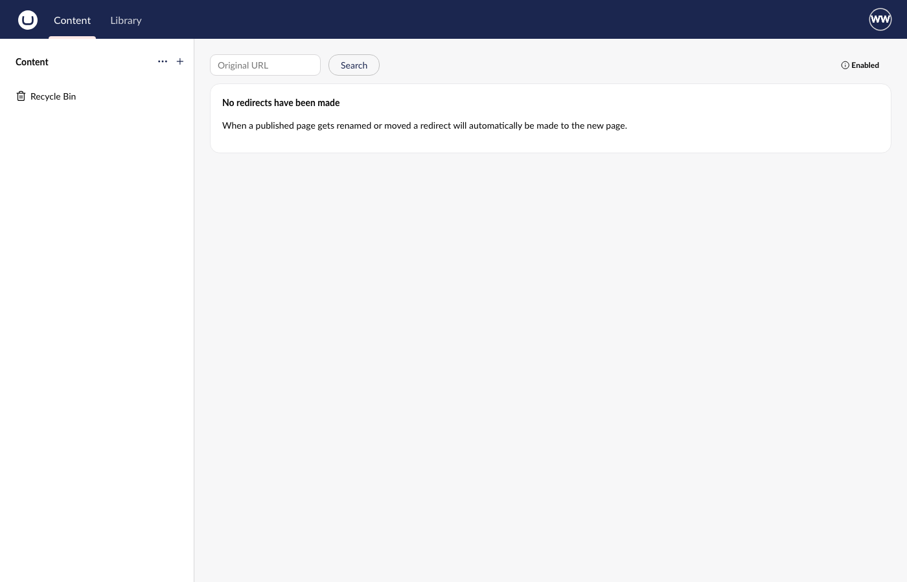

# Backoffice Tidy

Hide Umbraco backoffice extensions by alias, per environment and user group, from appsettings.

**Hiding is not access control.** Backoffice Tidy removes things from the user interface. It does not block anything:

- A hidden section is still reachable through its APIs, and by URL if the user has access to the section.
- A hidden Copilot leaves the Umbraco.AI APIs callable.
- Hidden dashboards still serve their data endpoints.
- To stop someone doing something, use user group permissions (and Umbraco.AI's own settings). Use this package only to tidy what people see.

[](https://github.com/PascalA94/Umbraco.Community.BackofficeTidy/actions/workflows/build.yml)
[](https://www.nuget.org/packages/Umbraco.Community.BackofficeTidy)
[](https://www.nuget.org/packages/Umbraco.Community.BackofficeTidy)
[](https://github.com/PascalA94/Umbraco.Community.BackofficeTidy/blob/main/LICENSE)

A community package, not made or supported by Umbraco HQ. Requires Umbraco 17 (17.8.0 or later) or Umbraco 18 (18.3.0 or later), on .NET 10.



## Supported versions

| Package version | Umbraco |
|---|---|
| 17.x | Umbraco 17 (17.8.0 or later, below 18) |
| 18.x | Umbraco 18 (18.3.0 or later, below 19) |

Install the package whose major version matches your Umbraco major version.

## Install

```bash
dotnet add package Umbraco.Community.BackofficeTidy
```

Nothing is hidden until you add rules. With no `BackofficeTidy` section the package does nothing.

## Configure

Add a `BackofficeTidy` section to `appsettings.json`. Keep all the rules in that one file and scope a rule with its `Environments` key rather than splitting rules across environment files (see the next paragraph):

```json
{
  "BackofficeTidy": {
    "Hide": [
      { "Preset": "WelcomeDashboard" },
      { "Preset": "Copilot", "Environments": ["Production"] },
      { "Alias": "Umb.HeaderApp.Search", "UserGroups": ["writer", "translator"] }
    ],
    "WarnUnknownAliases": true
  }
}
```

| Key | Meaning |
|---|---|
| `Hide` | A list of rules. Empty or missing hides nothing. |
| `Hide[].Alias` | The alias of one backoffice extension to hide. |
| `Hide[].Preset` | A named alias for a common extension (see below). |
| `Hide[].Environments` | Environment names the rule applies to, matched against the site's `ASPNETCORE_ENVIRONMENT` ignoring case. Empty means every environment. |
| `Hide[].UserGroups` | User group aliases the rule applies to, ignoring case. Empty means every user. A user in any one of the listed groups gets the rule. |
| `WarnUnknownAliases` | Default `true`. Writes one browser console warning for each configured alias that no extension uses. |

ASP.NET Core merges configuration arrays by index, field by field, across `appsettings.json` and `appsettings.<Environment>.json`, and a later file cannot remove an earlier entry. A `Hide` list in two files therefore combines entry 0 with entry 0 and so on, which can silently change a rule or make one invalid. Use one list and `Environments`.

A rule sets exactly one of `Alias` or `Preset`. Setting both or neither stops the site at start-up with an error that names the rule, for example `BackofficeTidy:Hide:0 sets both Alias and Preset; set exactly one.`

The server works out which aliases apply to the signed-in user, so one user never sees another group's rules.

### Presets

| Preset | Alias it hides |
|---|---|
| `WelcomeDashboard` | `Umb.Dashboard.UmbracoNews` (the Welcome tab on the Content dashboard) |
| `Copilot` | `UmbracoAIAgent.BackofficeEntryPoint.CopilotSidebar` (the Umbraco.AI Copilot button and sidebar) |

Umbraco.AI may rename its alias. If Copilot still shows after a package update, add its current alias by hand with `{ "Alias": "..." }` and please open an issue.

### Examples

Hide the Welcome dashboard for everyone, in every environment:

```json
{ "BackofficeTidy": { "Hide": [ { "Preset": "WelcomeDashboard" } ] } }
```

Hide Copilot on the live site only, so it still works in development:

```json
{ "BackofficeTidy": { "Hide": [ { "Preset": "Copilot", "Environments": ["Production"] } ] } }
```

Hide the search header app from writers, but not from admins:

```json
{ "BackofficeTidy": { "Hide": [ { "Alias": "Umb.HeaderApp.Search", "UserGroups": ["writer"] } ] } }
```

## Find an alias

In the backoffice, open **Settings**, then **Advanced Settings**, then **Extension Insights**. It lists every registered extension with its type and alias. Copy the alias into a rule.

If an alias has a typo, or its package is not installed, the browser console shows `BackofficeTidy: no extension with alias "<alias>" (typo, or the package is not installed).` once. Nothing else changes. Set `WarnUnknownAliases` to `false` to turn this off.

## What to expect

- An extension that is on screen when the backoffice starts can show for a moment, up to about 100 ms, before it is removed, and on a slow connection it can show for longer, because exclusion waits for the rules request. It goes away without a reload.
- If the package cannot load its rules (for example the request fails), nothing is hidden and the console shows `BackofficeTidy: could not load rules; nothing hidden.`
- Rules are read from configuration each time the backoffice asks, so an edit to a reloaded appsettings file applies to the next backoffice load. Restart the app if your host does not reload configuration. If an edit makes a rule invalid (for example both `Alias` and `Preset`), the running site does not stop: the request fails, nothing is hidden and the console shows the warning above. A restart with the same invalid rule fails at start-up.

## Uninstall

Remove the package (`dotnet remove package Umbraco.Community.BackofficeTidy`) and the `BackofficeTidy` section from your appsettings. Everything that was hidden comes back. The package stores nothing in the database.

## Develop

See `CLAUDE.md` for the commands, and `.github/CONTRIBUTING.md`. In short: `build/test.sh` restores, builds and tests both Umbraco lines; the demo site under `demo/` runs on HTTPS.

## Licence

MIT. See `LICENSE`. Security issues: see `SECURITY.md`.
